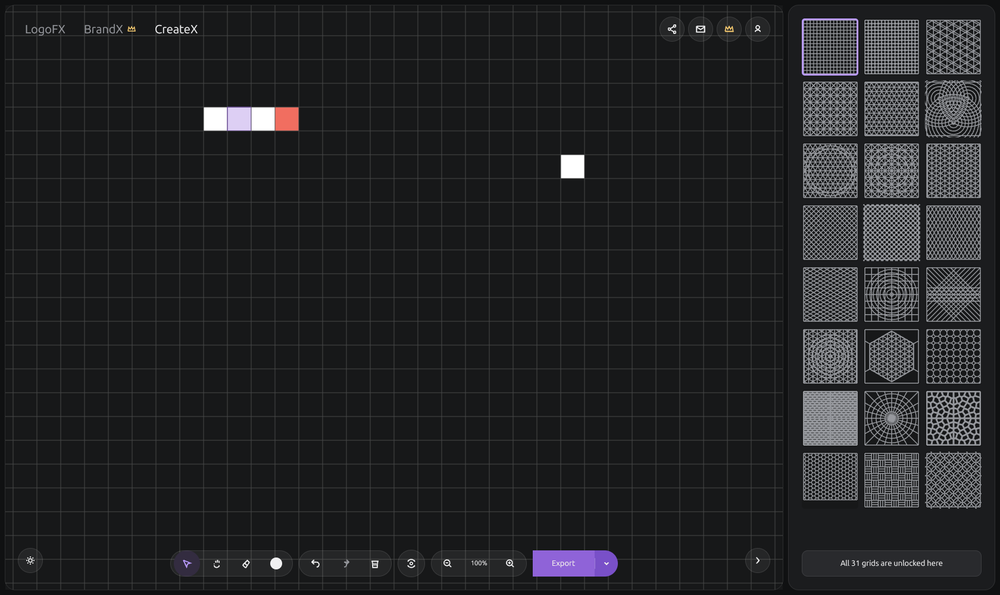
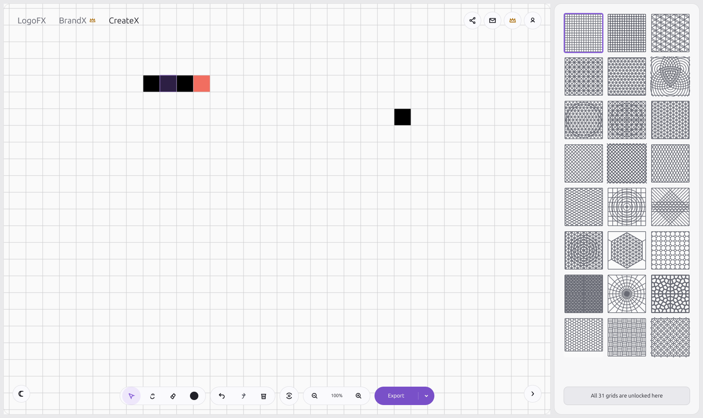

# Lattice

A grid logo maker for the desktop, written in Rust with GPUI. Paint cells on a
generated lattice, pick a colour, export SVG or PNG.



This is an independent reimplementation of the CreateX studio at
`logofx.app/createx`. The geometry engine was reverse engineered from the
shipped web bundle and ported line for line, and the interface follows the
measured tokens of the original. It is not affiliated with LogoFX.

## Why

CreateX sells the full grid set. The nine free lattices are public, the other
twenty four answer `401` without a membership, and export of a paid grid is
blocked. Lattice runs locally, has no accounts, no server, and no gate: all
thirty one lattices are available, including the six the original keeps out of
its gallery entirely.

## What it does

- **31 lattices.** Square, triangular, hexagonal, Voronoi, spiral, quadtree and
  the rest, each generated from a set of line and circle guides and cut into
  faces by a planar arrangement.
- **Infinite mirrored canvas.** The plane repeats a 240 unit tile with a mirror
  on odd columns and rows, so a drawing extends past the first tile without a
  seam.
- **Paint, erase, colour.** A pointer drag erases when it starts on a filled
  cell and paints when it starts on an empty one. Nine swatches plus a keyboard
  hex field. One undo reverses a whole stroke.
- **Undo and redo**, 80 steps deep. Clearing a grid takes two clicks.
- **Preview** hides the lattice and shows only the fills.
- **Zoom from 25 to 800 percent**, wheel zoom around the pointer, pan with the
  hand tool or by holding Space.
- **SVG and PNG export.** The SVG matches the original endpoint byte for byte
  for the reference drawing.
- **Dark and light themes.**
- **Autosave.** The drawing is written on every edit and restored on launch.



## Build and run

Requires Rust with edition 2024 support, which means 1.85 or newer.

```sh
cargo run -p lattice-app
```

On Linux the runtime package `libxkbcommon-x11` must be installed. The build
script finds it, and if only the versioned `.so.0` exists it links against that
without touching your system. On a session whose Wayland compositor is older
than `xdg_wm_base` version 2, run it on X11:

```sh
env -u WAYLAND_DISPLAY cargo run -p lattice-app
```

The window refuses to go below 1280 by 800, the size at which the floating
transport still clears the corner buttons.

## Releases

Every push to `main` builds release binaries for Linux, Windows and macOS and
uploads them as workflow artifacts. Pushing a tag such as `v0.1.0` attaches the
same binaries to a GitHub release.

The Linux binary needs `libxkbcommon-x11`, `libwayland`, `libX11` and a Vulkan
loader at runtime, which a normal desktop already has.

## Where files live

| Platform | Drawing | Exports |
|---|---|---|
| Linux | `$XDG_DATA_HOME/lattice` | `$XDG_PICTURES_DIR` or `~/Downloads` |
| macOS | `~/Library/Application Support/Lattice` | `~/Downloads` |
| Windows | `%APPDATA%\Lattice` | `%USERPROFILE%\Pictures` |

Both locations can be redirected with `LATTICE_DATA_DIR` and
`LATTICE_EXPORT_DIR`.

## Keyboard

| Key | Action |
|---|---|
| `1` `2` `3` `4` | Pointer, hand, eraser, colour |
| `Space` | Pan while held |
| Arrows | Nudge the view |
| `Ctrl+Z`, `Ctrl+Shift+Z` | Undo, redo |
| `Enter` | Toggle the focused cell |
| `Esc` | Leave preview, or cancel hex entry |

## How it is verified

```sh
cargo test
```

28 tests, no display, network, or GPU needed. The interesting ones:

- **Geometry parity.** All 31 lattices in both layouts, 62 cases and 19 982
  cells, compared byte for byte against the functions extracted from the
  original bundle.
- **Export parity.** The SVG for the reference drawing is reproduced byte for
  byte and checked against a golden file.
- **Pointer and keyboard.** Tests drive the real element tree: clicking every
  control by element id, painting, dragging, undo, hex entry, the two click
  trash confirmation, autosave across a restart, and PNG export contents.

`fixtures/` holds the golden data, so the suite runs without the original
bundle. Regenerating the fixtures needs that bundle and is described in
[docs/testing.md](docs/testing.md).

The interface was checked against a real screenshot of the target at
1680x1000. `tools/screenshot/` grabs a window through X11 and
`compare.py` prints the layout geometry, so a difference is a number. The
measured values are in [docs/ui-spec.md](docs/ui-spec.md).

Platform status: Linux is built and run. The Windows and macOS code paths are
in place and the core crate type checks for `x86_64-pc-windows-msvc`, but the
app has not been compiled on either platform.

## Project layout

```
crates/lattice-core   geometry, documents and export. No windowing, no GPU
crates/lattice-app    the GPUI studio: theme, icons, canvas, shell
tools/parity          extracts the reference engine and dumps golden fixtures
tools/screenshot      X11 screen capture, PNG reader, layout comparison
fixtures              golden cells, tile transforms, reference export
docs                  architecture, geometry, UI spec, decisions, testing
```

## Documentation

- [Architecture](docs/architecture.md), the crate split and the data flow
- [Geometry](docs/geometry.md), guides, the arrangement, tiling and hit testing
- [UI specification](docs/ui-spec.md), tokens, layout and measured deltas
- [Reverse engineering](docs/reverse-engineering.md), what was inspected and how
- [Decisions](docs/decisions.md), why things are the way they are
- [Testing](docs/testing.md), what is covered and what still needs a human

## Licences

- This code is MIT, see [LICENSE](LICENSE).
- Inter is bundled under the SIL Open Font License, see
  `crates/lattice-app/assets/OFL.txt`.
- The icon glyphs are drawn as paths, after the Lucide set (ISC).
- The geometry is reimplemented from observable behaviour of the original
  studio, not copied from its source.
